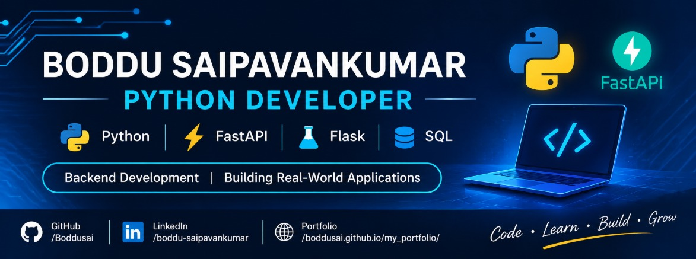

<!-- PROFILE BANNER -->

  

<h1 align="center">Hi 👋, I'm Boddu Saipavankumar</h1>

<h3 align="center">
  Python Developer | Backend Developer | FastAPI Enthusiast
</h3>

  
  
  

---

## 👨‍💻 About Me

- 🎯 Aspiring Python Backend Developer.
- 🐍 Passionate about Python and backend development.
- ⚡ Building REST APIs using FastAPI and Flask.
- 🗄️ Interested in SQL, databases and AI-powered applications.
- 🚀 Always learning and building practical projects.

---

## 🛠️ Technical Skills

### Programming Languages

  

### Frameworks & Tools

  

### Database

  

---

## 🚀 Featured Projects

| Project | Description |
|---|---|
| [FastAPI Task Manager](https://github.com/Boddusai/task-manager) | REST API for managing tasks |
| [Maneendra General Stores](https://github.com/Boddusai/maneendra-general-stores-fullstack) | Full-stack grocery store website |
| [Vijaypaul Milk & Cooldrinks](https://github.com/Boddusai/vijaypaul-milk-cooldrinks) | Online milk and cool drinks store |
| [AI Exam Proctoring](https://github.com/Boddusai/CODING-SAMURAI-INTERNSHIP-TASKS) | AI-based exam monitoring project |

---

## 📊 GitHub Statistics

  
  

  

---

## 🤝 Connect With Me

  <a href="https://www.linkedin.com/in/boddu-saipavankumar-6418a5276/">LinkedIn</a> •
  <a href="https://boddusai.github.io/my_portfolio/">Portfolio</a> •
  <a href="https://github.com/Boddusai">GitHub</a>

  ⭐ Thanks for visiting my profile!

